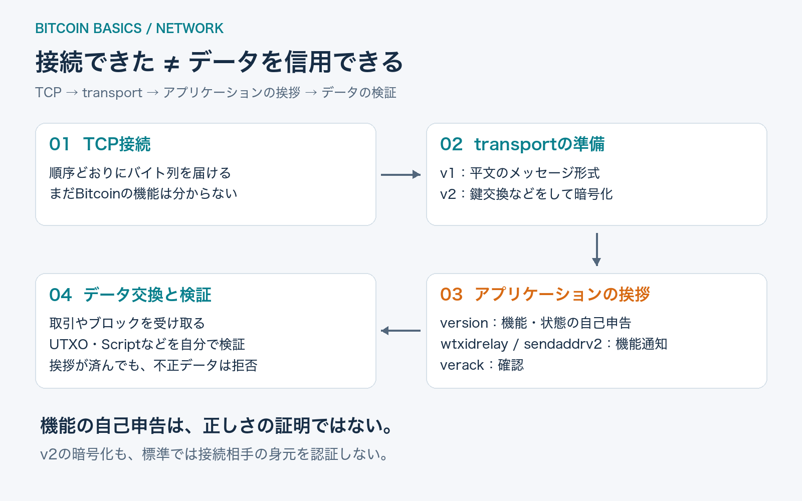
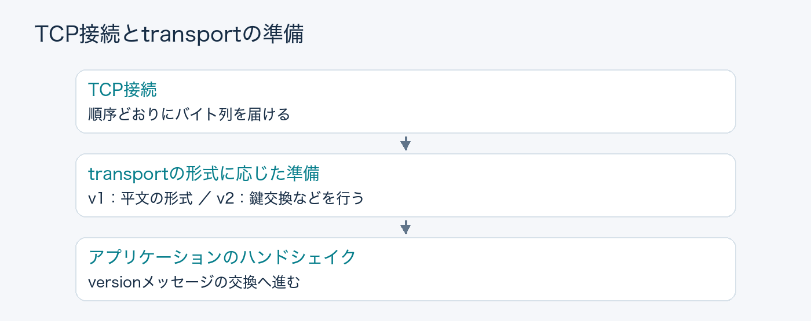
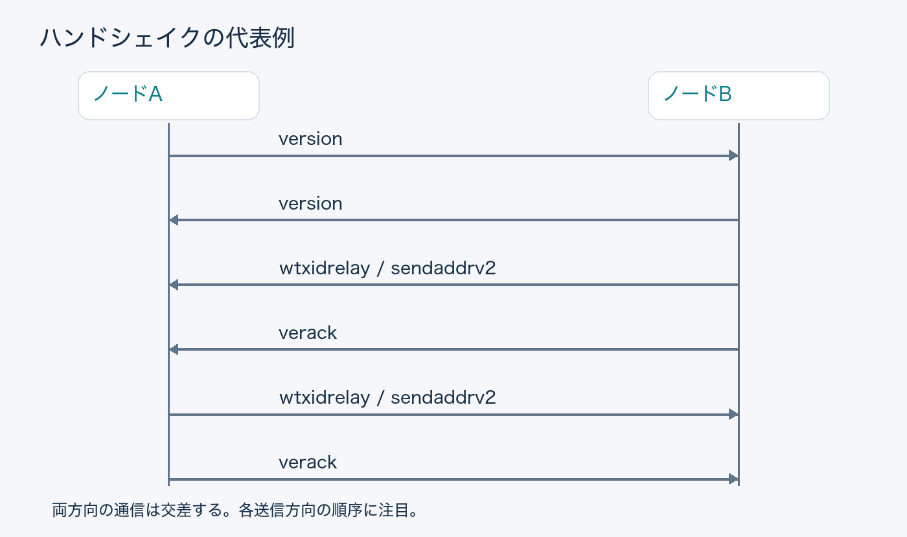
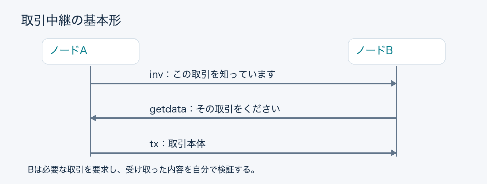

## はじめに

Bitcoinノードが別のノードにTCP接続できたとします。すぐに取引やブロックを送り始めればよいでしょうか。

相手が使うプロトコル、提供できるデータ、受け取りたいメッセージ形式は、接続できただけでは分かりません。そこでノード同士は、最初に短いやり取りをします。

この記事では、ノードAからノードBへの接続を例に、**接続してからBitcoinのデータを交換するまで**を追います。接続先の探し方や、ブロック同期の詳細は扱いません。

**読了目安：7〜9分。** Bitcoin Core v32.1と関連BIPを参照しています。通常のデータ交換用接続を対象にし、疎通確認などの特殊な接続は省きます。

## 1. TCP接続は、会話の通り道を作るだけ

TCPは、バイト列を順序どおりに届けるための仕組みです。それだけでは、どこからどこまでがBitcoinの一つのメッセージなのかは分かりません。

Bitcoin側には、そのバイト列をメッセージとして運ぶ**transport**の層があります。従来のv1 transportは平文で、BIP324のv2 transportでは暗号化の準備をしてからアプリケーションのメッセージを運びます。

ここでいうv2は、後で登場する`version`メッセージの数字とは別です。**transportの準備と、Bitcoinの機能を確認する会話は異なる段階**にあります。

また、BIP324の暗号化は、標準では相手の身元を認証しません。通信を受動的に盗み見ることを難しくしても、接続先が正直なノードだと証明するものではありません。

## 2. versionは「自分はこういうノードです」という自己紹介

アプリケーションの会話は`version`から始まります。AとBは、それぞれ自分の情報を送ります。

主要な項目を整理すると、次のようになります。

| 項目 | 相手に伝えること |
| --- | --- |
| protocol version | どの世代のP2Pプロトコルを話せるか |
| services | どのようなサービスを提供するか |
| user agent | ソフトウェア名やバージョンの自己申告 |
| start height | 自分が把握しているチェーンの高さ |
| nonce | 自分自身への接続を検出するための値 |
| relay | 通常の取引中継を受けたいかという初期設定 |

`services`は機能を表すビットの集合です。たとえば、過去のブロックを提供できるノードと、保持する範囲が限られたノードでは、依頼できる仕事が違います。

ただし、これは**自己申告**です。高いブロック高を名乗ったから正しいチェーンを持っているわけでも、user agentに有名な実装名が入っているから安全なわけでもありません。

一方、会話を続ける条件の判定には使えます。Coreは相手のプロトコルが古すぎる場合や、その接続に期待するサービスが提供されない場合などに、接続を切る処理を持っています。

ここで交換しているのは「あなたを信用します」という証明書ではなく、**この接続を何に使えるかを判断する情報**です。

## 3. versionとverackの間に、機能の通知が入る

`version`を受け取ったら、`verack`で応答します。名前はversion acknowledgementの略で、ペイロードを持たない確認メッセージです。

ただし、現代の接続を「version、verackの2種類だけ」と考えると、重要な部分を見落とします。その間に送る機能通知があります。

図は対応する機能を双方が通知する例です。双方向のメッセージは交差するため、ネットワーク全体で必ずこの並びになるわけではありません。大事なのは、各方向で守るべき順序です。

### wtxidrelay：取引をどのIDで知らせるか

SegWitの取引には、witnessを含めない識別子`txid`と、witnessも含めた識別子`wtxid`があります。

BIP339の`wtxidrelay`は、wtxidを使った取引の通知を受け取れることを伝えます。取引IDの形式を接続途中で切り替えると、通知と要求の解釈が食い違う可能性があります。そのため、送信側は相手の`version`を受信した後、自分の`verack`を送る前に通知します。

### sendaddrv2：接続先情報をどの形式で受け取るか

BIP155の`sendaddrv2`は、新しいアドレスメッセージ形式を受信できることを伝えます。`addrv2`は、従来の形式で扱いにくかったTor v3などのアドレスを運べます。

これも`verack`の前に通知します。Core v32.1では、相手の`verack`を処理して接続完了になった後に`wtxidrelay`や`sendaddrv2`を受信すると、接続を切ります。

**同じメッセージでも、届くタイミングが違えばプロトコル違反になる。** ここに、単なるメッセージの一覧では見えない状態管理があります。

なお、すべての機能通知がこのタイミングに集まるわけではありません。通知の順序は機能ごとに定義されます。

## 4. verackは「これから送るデータが正しい」という意味ではない

ハンドシェイクが済むと、接続の用途や相手の状態に応じて、ヘッダーの要求、取引の通知、ブロックの取得などが進みます。

取引中継の基本形は、次のように理解できます。

これは概念をつかむための基本形です。重複の抑制や送信タイミング、他の中継方式などの詳細は省いています。

ポイントは、**「相手と話せるようになった」と「相手が送った取引を受け入れる」は別の判定**だということです。

取引を受け入れるには、使用する出力が存在するか、二重に使っていないか、金額が整合するか、Scriptの条件を満たすかなどを確認します。mempoolへ受け入れる場合には、ノードのポリシーによる判定もあります。

ハンドシェイクを丁寧に終えた相手でも、不正な取引を送ることはできます。Bitcoinは、最初の挨拶で相手を信用して、その後の検証を省略する設計ではありません。

## 5. 実装では「接続中」を一つの状態にしない

ソケットが開いている接続を、すべて同じように扱うと何が起きるでしょうか。

まだ相手の機能を確認していないのに、その機能を前提にしたデータを送るかもしれません。あるいは、取引IDの扱いを決めた後に、遅れて届いた通知で設定を書き換えてしまうかもしれません。

そこで実装は、相手の`version`を受け取ったか、`verack`まで進んだか、どの機能を通知されたかを記録し、処理できるメッセージを判断します。

Coreのソースを読むなら、`src/net_processing.cpp`で以下を探すと、この記事の流れをたどれます。

| 検索する文字列 | 読む場所 |
| --- | --- |
| `NetMsgType::VERSION` | 自己申告の読み取り、機能通知とverackの送信 |
| `NetMsgType::VERACK` | 接続完了へ進む処理 |
| `NetMsgType::WTXIDRELAY` | 通知のタイミングと状態の検査 |
| `NetMsgType::SENDADDRV2` | アドレス形式の通知と状態の検査 |

関数全体を一度に理解する必要はありません。まず「このメッセージを受け取った時点で、何が済んでいる必要があるか」を追うと、処理の意図が見えます。

## おわりに

Bitcoinの接続開始には、通り道を作る、メッセージの運び方を整える、機能を通知する、という段階があります。それらが終わっても、取引やブロックの正しさは別途検証します。

この区別を押さえると、P2P実装を「データを送受信するコード」から、**相手との会話の進み具合を管理するコード**として読めるようになります。

受け取った取引の支払い条件をどう検証するかは、同シリーズの「Bitcoin Scriptは、いつ・何を材料に実行されるのか？」で扱います。

## 参考資料

最終確認日：2026-11-09。コードの参照対象はBitcoin Core **v32.1**。本記事では通信キャプチャによる実測は行っていません。

- [Bitcoin Core v32.1: net_processing.cpp](https://github.com/bitcoin/bitcoin/blob/v32.1/src/net_processing.cpp)
- [BIP324: Version 2 P2P Encrypted Transport Protocol](https://github.com/bitcoin/bips/blob/master/bip-0324.mediawiki)
- [BIP339: Wtxid-based Transaction Relay](https://github.com/bitcoin/bips/blob/master/bip-0339.mediawiki)
- [BIP155: addrv2 message](https://github.com/bitcoin/bips/blob/master/bip-0155.mediawiki)
- [Bitcoin Developer Reference: P2P Network](https://developer.bitcoin.org/reference/p2p_networking.html) — 基本メッセージの補助資料。古いバージョンの記述を含むため、現在の順序は上記コードとBIPを参照。

## 更新履歴

- 2026-11-09: 初版公開
