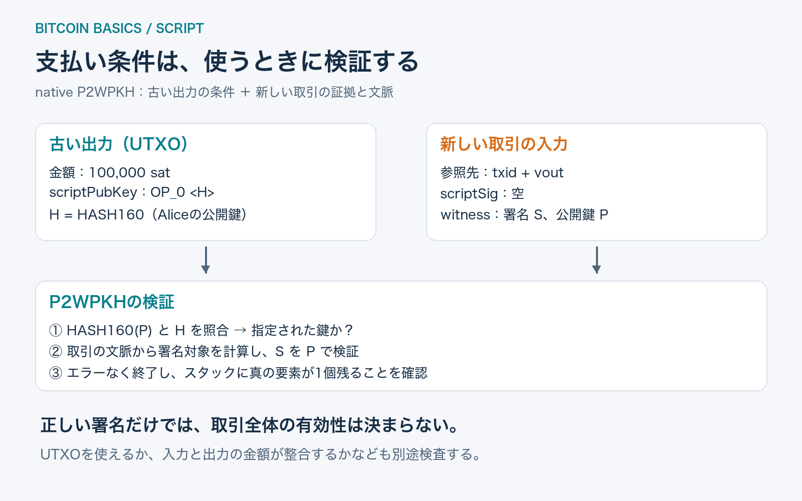
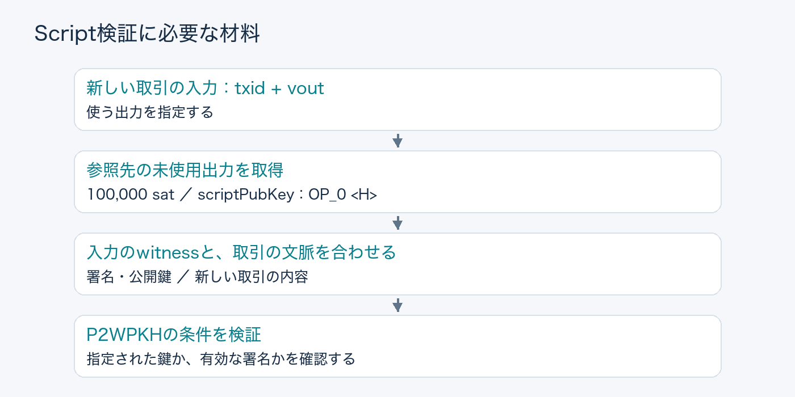
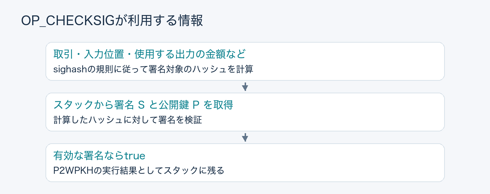
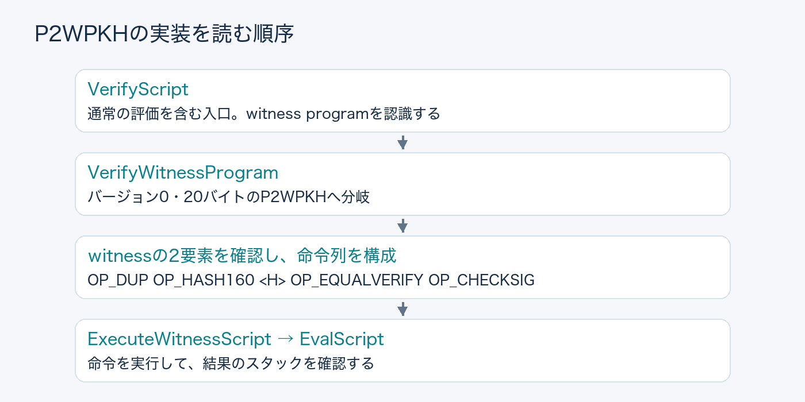

## はじめに

「Bitcoinを使うには、正しい署名が必要」と聞くと、ノードが取引のどこかにある署名を検証して、終わりのように思えます。

しかし、署名を何の公開鍵で検証するのでしょうか。使える条件はどこに書かれ、誰がその条件を決めたのでしょうか。

この記事では、**一つのUTXOを使う取引**を例に、ノードが材料をそろえてScriptを検証するまでを追います。対象はnative P2WPKHというSegWit v0の出力形式です。P2SHやTaprootの実行経路は扱いません。

**読了目安：7〜9分。** Bitcoin Core v32.1とBIP141・143を参照しています。取引の入力と出力があることだけ分かっていれば読める構成です。



## 1. 条件は、使う取引ではなく「使われる出力」にある

Aliceが過去に受け取った100,000 satを、Bobへの支払いに使うとします。

古い取引の出力には、金額と`scriptPubKey`が記録されています。名前にPubKeyとありますが、常に公開鍵そのものが入っているわけではありません。**その出力を使うための条件を表すScript**です。

今回の出力を、次のように表します。

```text
古い取引の出力（UTXO）
  金額: 100,000 sat
  scriptPubKey: OP_0 <H>

H = HASH160(Aliceの公開鍵)  // 20バイト
```

`HASH160`はSHA-256の結果をRIPEMD-160に通す操作です。`<H>`はその値をスタックへ積む表記で、文字列「H」を保存する意味ではありません。

この`OP_0`と20バイトのデータの組み合わせは、P2WPKHのwitness programとして認識されます。「公開鍵のハッシュがHに一致し、その鍵に対応する有効な署名を提示できること」が、ここで使う条件です。

Aliceが今から作る支払いの出力は、たとえばこうなります。

```text
入力: AliceのUTXO   100,000 sat
出力: Bobへの支払い  60,000 sat
出力: Aliceのお釣り  39,000 sat
差額: 手数料         1,000 sat
```

今回検証するのは、**Aliceが使う古い出力の条件**です。新しいBobの出力の使用条件は、Bobが後でそれを使う際に満たす必要があります。出力を作る時点で、将来の支出に必要な署名を要求するわけではありません。

## 2. 入力はUTXOを指し、witnessは証拠を渡す

新しい取引の入力は、`txid`と出力番号`vout`の組み合わせで、使う出力を指定します。この組み合わせを**outpoint**と呼びます。

ただし、指定しただけでは使う権限を示せません。P2WPKHでは、入力に対応するwitnessに署名と公開鍵を入れます。



材料の置き場所は、次のように分かれます。

| 場所 | 今回の内容 |
| --- | --- |
| 古い出力 | 金額と`scriptPubKey` |
| 新しい取引の入力 | 古い出力を指すoutpoint |
| その入力の`scriptSig` | 空 |
| その入力のwitness | 署名、公開鍵の2要素 |

native P2WPKHでは`scriptSig`は空でなければなりません。「署名は必ずscriptSigに入る」と考えると、SegWitの処理を読み違えます。

ノードは取引の文脈に応じたUTXOのビューから、参照先の出力を探します。入力が指定した出力を使えるかという検査と、そこに書かれたScriptを満たすかという検査は、両方必要です。

## 3. 短いwitness programから、実行するScriptが決まる

`OP_0 <H>`だけを見ても、署名を検証する命令はありません。どこで署名チェックが起きるのでしょうか。

SegWit対応の検証では、この出力を**バージョン0・20バイトのwitness program**として認識し、P2WPKH用の処理へ進みます。そこで、次のScriptを組み立てて実行します。

```text
OP_DUP OP_HASH160 <H> OP_EQUALVERIFY OP_CHECKSIG
```

これは古い出力に長いScriptが隠れているという意味ではありません。短い形式を認識した検証規則が、実行する処理を決めています。

Coreの`VerifyWitnessProgram`でも、witnessの要素が2個であることを確認したうえで、この命令列を組み立てています。

初期スタックには、witnessから署名と公開鍵が載ります。以下では左が底、右が先頭です。`S`は署名、`P`は公開鍵、`H`は古い出力に記録されたハッシュです。

| 処理 | 処理後のスタック | 何をしたか |
| --- | --- | --- |
| 初期状態 | `[S, P]` | witnessの2要素で開始 |
| `OP_DUP` | `[S, P, P]` | 公開鍵を複製 |
| `OP_HASH160` | `[S, P, HASH160(P)]` | 複製した公開鍵をハッシュ化 |
| `<H>` | `[S, P, HASH160(P), H]` | 要求されたハッシュを積む |
| `OP_EQUALVERIFY` | `[S, P]` | 二つのハッシュを比較。不一致なら失敗 |
| `OP_CHECKSIG` | `[true]` | 署名が有効だった場合 |

公開鍵を複製するのは、ハッシュの照合後も、署名検証のために元の公開鍵が必要だからです。

**公開鍵のハッシュ照合と、署名の検証は別の仕事です。** 前者は「この出力が指定する鍵か」、後者は「この支出について有効な署名か」を確かめます。

## 4. OP_CHECKSIGは、スタックの外も参照する

スタック上には署名と公開鍵があります。しかし、署名検証には、署名の対象となるメッセージも必要です。

`OP_CHECKSIG`は「公開鍵に対して何らかの有効な署名なら合格」という命令ではありません。新しい取引と入力の文脈から、署名対象のハッシュを計算して検証します。



SegWit v0の計算方法はBIP143が定義しています。使用する出力の金額も署名対象に含まれます。どの入力・出力を含めるかは、署名に付くsighash typeによって変わります。

今回、Aliceが通常の`SIGHASH_ALL`で署名したとします。この場合、Bobへの60,000 satとAliceへの39,000 satという出力も署名対象に含まれます。第三者がBobの受取額を書き換えれば、署名対象のハッシュが変わり、元の署名は通りません。

一方、すべてのsighash typeが同じ範囲を固定するわけではありません。ここでは「署名は取引から作ったハッシュに対して検証され、その作り方にも規則がある」と押さえれば十分です。

また、Scriptが取引の文脈を利用することと、任意の外部データを取得できることは別です。実行中にウェブへ問い合わせたり、外部の価格を取得したりする機構はありません。

## 5. Scriptが通っても、取引全体の検証は終わらない

今回のP2WPKHでは、実行がエラーなく終了し、スタックに真と解釈できる要素が一つだけ残る必要があります。単に「最後の命令まで走った」だけでは成功になりません。

ただし、この条件を満たしたことは、取引全体が有効であることと同義ではありません。

たとえば、Aliceが正しい鍵を使い、100,000 satの入力に対して合計110,000 satの出力を作り、その内容に署名したとします。署名が正しくても、存在しない10,000 satを増やす取引は受け入れられません。

| 判定 | 確認するもの |
| --- | --- |
| Scriptの検証 | 指定された使用条件を満たすか |
| 入力・金額などの検証 | 参照先を使えるか、金額が範囲内で整合するかなど |
| mempoolのポリシー | 未承認取引として保持・中継する条件を満たすか |

これらは役割の整理で、実装が必ず表の順に動くという意味ではありません。

Script検証は、mempoolへ取引を受け入れる経路や、ブロックを検証する経路に組み込まれています。ただし、キャッシュなどがあるため、同じ取引を受け取るたびに全署名を必ず再計算するという意味でもありません。

## 6. ソースでは、入口・分岐・実行を分けて読む

Core v32.1の`src/script/interpreter.cpp`では、次の順で関数を見ると追いやすくなります。



図はP2WPKHに注目した抜粋です。実装では`VerifyScript`の中にも通常のScript評価があり、ほかの出力形式へ進む分岐もあります。

最初から全命令を覚えるより、**どの出力形式を、どの規則と初期スタックで実行するのか**を先に確認するほうが、処理を読み違えにくくなります。

## おわりに

Bitcoinの支出検証では、古い出力が条件を指定し、新しい取引がその出力を参照して、witnessなどに必要な材料を渡します。

P2WPKHなら、公開鍵のハッシュを照合し、取引の文脈から作ったハッシュに対して署名を検証します。Scriptだけでなく、UTXOや金額の検査と組み合わせることで、取引を受け入れられるかが決まります。

## 参考資料

最終確認日：2026-11-09。コードの参照対象はBitcoin Core **v32.1**。金額とスタックの例は説明用で、実トランザクションの生成・送信は行っていません。

- [Bitcoin Core v32.1: interpreter.cpp](https://github.com/bitcoin/bitcoin/blob/v32.1/src/script/interpreter.cpp) — `VerifyScript`、`VerifyWitnessProgram`、`ExecuteWitnessScript`、`EvalScript`
- [BIP141: Segregated Witness](https://github.com/bitcoin/bips/blob/master/bip-0141.mediawiki) — P2WPKHのwitnessと成功条件
- [BIP143: Transaction Signature Verification for Version 0 Witness Program](https://github.com/bitcoin/bips/blob/master/bip-0143.mediawiki) — 署名対象の構築
- [Bitcoin Developer Guide: Transactions](https://developer.bitcoin.org/devguide/transactions.html) — 入力、出力、outpointの基礎。Legacy中心の資料のため、witnessの説明はBIP141を参照。

## 更新履歴

- 2026-11-09: 初版公開
